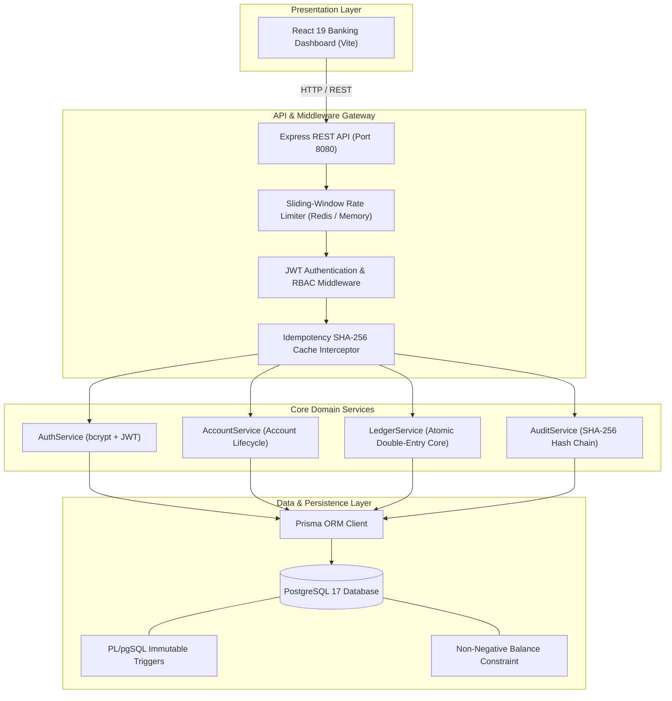
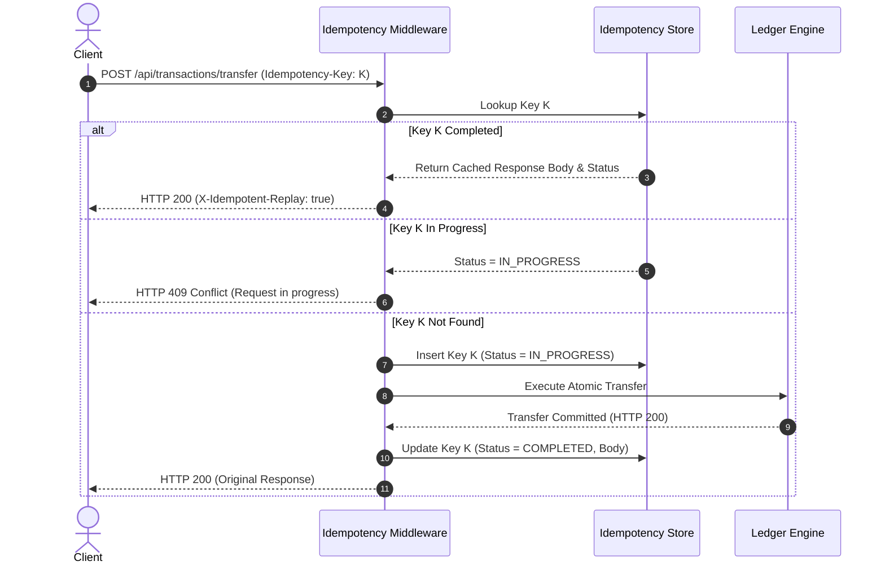

# BalanceVault Technical Architecture & System Design (ARCHITECTURE.md)

BalanceVault is an enterprise double-entry banking and ledger management system engineered to guarantee financial invariants, concurrency safety, and cryptographic auditability under demanding production workloads.

---

## 1. High-Level System Architecture



---

## 2. Mathematical Formalization of Double-Entry Accounting

In traditional single-entry ledgers, account balances are mutated independently, which introduces systemic vulnerabilities: balances can be altered without a balancing counterparty, leading to unaccounted inflation or lost funds.

BalanceVault enforces classical **double-entry bookkeeping** at the fundamental data model level:

### 2.1. The Double-Entry Equilibrium Equation
Every financial event produces a `JournalEntry` containing an array of balanced `Posting` records $P = \{p_1, p_2, \dots, p_n\}$. Each posting $p_i$ has a signed magnitude $\Delta_i$ representing the directional change in account equity:
$$\sum_{i=1}^{n} \Delta_i = 0$$

For standard two-legged banking operations:

1. **Deposit**:
   $$\Delta_{\text{Customer}} = +A \quad (\text{CREDIT})$$
   $$\Delta_{\text{System Reserve}} = -A \quad (\text{DEBIT})$$
   $$(+A) + (-A) = 0$$

2. **Withdrawal**:
   $$\Delta_{\text{Customer}} = -A \quad (\text{DEBIT})$$
   $$\Delta_{\text{System Reserve}} = +A \quad (\text{CREDIT})$$
   $$(-A) + (+A) = 0$$

3. **Account-to-Account Transfer**:
   $$\Delta_{\text{Source}} = -A \quad (\text{DEBIT})$$
   $$\Delta_{\text{Destination}} = +A \quad (\text{CREDIT})$$
   $$(-A) + (+A) = 0$$

### 2.2. Global System Conservation Invariant
At any point in time $t$, the sum of all account balances across the bank (including the Central Reserve Vault) equals identically zero:
$$\sum_{k \in \text{All Accounts}} \text{Balance}_k(t) = 0$$

The invariant inspector endpoint `/api/admin/ledger/verify-invariants` computes this equation in real-time across all journal entries and postings in the database.

---

## 3. Concurrency Safety & Deadlock Elimination

In high-throughput environments, multiple clients may initiate simultaneous debit requests on the same account or circular transfers between accounts.

### 3.1. Row-Level Locking (`FOR UPDATE`)
Before checking balances or applying postings, affected accounts are locked using PostgreSQL's row-level lock:
```sql
SELECT id, balance, status FROM "Account"
WHERE id IN ($1, $2)
ORDER BY id ASC
FOR UPDATE;
```

### 3.2. Lexicographical Lock Ordering
A classic relational concurrency problem is the **cross-transfer deadlock**:
- Transaction 1 transfers from Account A to Account B.
- Transaction 2 transfers from Account B to Account A.
- If T1 locks A and waits for B, while T2 locks B and waits for A, a deadlock occurs.

**BalanceVault Solution**:
In `LedgerService.transfer()`, target account UUIDs are sorted lexicographically before acquiring locks:
```typescript
const sortedIds = [sourceCheck.id, destCheck.id].sort();
```
Both T1 and T2 invariably request locks in the exact same order ($A$, then $B$), completely eliminating circular wait conditions and database deadlocks.

---

## 4. Dual-Layer Overdraft Defense

BalanceVault implements two independent, redundant layers of overdraft protection:

1. **Application-Layer Validation**:
   Under an active row lock, `LedgerService` checks:
   ```typescript
   if (currentBalance.lessThan(amountDecimal)) {
     throw new BadRequestError('Overdraft prevented: Insufficient funds.');
   }
   ```
2. **Database-Level Check Constraint**:
   ```sql
   ALTER TABLE "Account"
   ADD CONSTRAINT account_balance_non_negative_check
   CHECK (balance >= 0 OR "accountType" = 'SYSTEM_RESERVE');
   ```
   Even if an application code defect or raw SQL execution attempts to write a negative customer balance, the PostgreSQL engine physically rejects the transaction with constraint violation `23514`.

---

## 5. Append-Only Tamper-Resistant Ledger

Financial regulations require that once a ledger record or audit event is posted, it must never be modified or deleted.

### 5.1. Database-Level PL/pgSQL Triggers
The PostgreSQL engine executes trigger `prevent_audit_ledger_mutation()` on `BEFORE UPDATE OR DELETE`:
```sql
CREATE OR REPLACE FUNCTION prevent_audit_ledger_mutation()
RETURNS TRIGGER AS $$
BEGIN
  RAISE EXCEPTION 'Audit ledger and financial postings are append-only. UPDATE and DELETE operations are strictly prohibited by database security policy.';
END;
$$ LANGUAGE plpgsql;

CREATE TRIGGER postings_immutable_trigger
BEFORE UPDATE OR DELETE ON "Posting"
FOR EACH ROW EXECUTE FUNCTION prevent_audit_ledger_mutation();

CREATE TRIGGER audit_ledger_immutable_trigger
BEFORE UPDATE OR DELETE ON "AuditLedger"
FOR EACH ROW EXECUTE FUNCTION prevent_audit_ledger_mutation();
```

### 5.2. Cryptographic SHA-256 Hash Chaining
Every `AuditLedger` event records:
- `prevHash`: The SHA-256 digest of the immediately preceding audit event.
- `currentHash`: $\text{SHA-256}(\text{prevHash} \parallel \text{action} \parallel \text{entityType} \parallel \text{entityId} \parallel \text{actorId} \parallel \text{payload} \parallel \text{timestamp})$.

This creates an immutable cryptographic chain. Any out-of-band tampering (e.g. by a superuser with disabled triggers) is immediately detectable via `auditService.verifyAuditChainIntegrity()`.

---

## 6. Idempotency & Operation Replay Defense

Network timeouts frequently prompt web or mobile applications to retry requests.



---

## 7. Redis-Based Rate Limiting with Fallback

BalanceVault protects sensitive authentication and transactional endpoints with a sliding-window rate limiter:
- **Auth Endpoints**: 15 requests per 60 seconds.
- **Financial Endpoints**: 30 requests per 60 seconds.
- **Global Endpoints**: 100 requests per 60 seconds.

If Redis becomes unreachable, the rate limiter automatically activates an in-memory sliding window cache without dropping incoming traffic, logging health status as `DEGRADED` on `/api/health/ready`.
