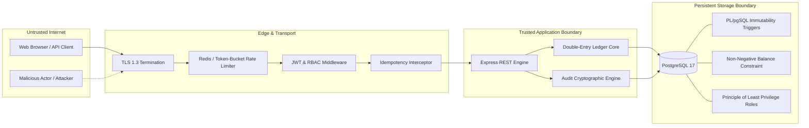

# BalanceVault Threat Model & Security Architecture (THREATS.md)

This document formalizes the threat landscape, attack surface analysis, and defense-in-depth mitigations for the **BalanceVault** high-assurance double-entry financial platform.

---

## 1. System Overview & Security Boundaries

BalanceVault operates as a mission-critical transactional banking system. Its primary security mandates are:
1. **Mathematical Conservation of Money**: No money may be created, destroyed, or misattributed through concurrent execution or system faults ($\sum \text{Postings} = 0$).
2. **Zero Overdraft Guarantee**: Non-reserve accounts must strictly never fall below zero ($Balance \ge 0$).
3. **Audit Ledger Immutability**: Historical financial records and audit events must be tamper-proof and append-only.
4. **Operation Idempotency**: Network retransmissions and client retries must never result in duplicate financial postings.



---

## 2. STRIDE Threat Analysis Matrix

| Threat Category | Specific Threat Vector | Severity | Architectural Mitigation in BalanceVault | Verification Test |
|---|---|:---:|---|---|
| **Spoofing** | Credential theft, JWT forgery, session hijacking | **High** | Strong bcrypt (10 rounds) password hashing; cryptographically signed JWTs with expiration; strict Bearer token header parsing; no sensitive token data stored in logs. | `authService.test.ts`, auth rejection on malformed tokens. |
| **Tampering** | Rogue actor or insider issuing `UPDATE` or `DELETE` on financial ledger or audit records | **Critical** | Database-level PL/pgSQL triggers (`prevent_audit_ledger_mutation()`) intercepting any `UPDATE` or `DELETE` on `Posting`, `JournalEntry`, and `AuditLedger`. Additionally, SHA-256 cryptographic hash chaining links every audit record. | `append-only-triggers.test.ts` (verifies DB throws exception). |
| **Repudiation** | User denies authorizing a transfer or withdrawal | **Medium** | Every state-modifying action records an append-only entry in `AuditLedger` capturing `actorId`, `actorRole`, `ipAddress`, `userAgent`, timestamp, and serialized payload hash. | `auditService.verifyAuditChainIntegrity()`. |
| **Information Disclosure** | Leakage of account balances, cross-account exposure, stack trace leaks in API errors | **High** | Strict object-level ownership checks (`account.userId === req.user.id`); centralized `errorHandler` sanitizes internal errors and removes stack traces in production; passwords excluded from Prisma selects. | API response schema validation. |
| **Denial of Service** | Rapid brute-force attacks on `/auth/login`, API flooding of financial transfer endpoints | **High** | Redis-backed sliding-window rate limiting (`authRateLimiter`: 15 req/min, `financialRateLimiter`: 30 req/min) returning HTTP 429 with `Retry-After`. Resilient in-memory fallback if Redis disconnects. | `rate-limiting.test.ts` (18 rapid requests trigger 429). |
| **Elevation of Privilege** | Standard customer calling admin endpoints to view all bank accounts or freeze accounts | **Critical** | Role-Based Access Control (`authorizeRoles(UserRole.ADMIN, UserRole.AUDITOR)`) enforced at route definition level before handler invocation. | Admin route RBAC tests returning HTTP 403 Forbidden. |

---

## 3. Financial-Specific Attack Vectors & Mitigations

### 3.1. Race Condition / Concurrent Double-Spending
- **The Threat**: A user with $100 sends 10 simultaneous transfer or withdrawal requests of $25 each across parallel HTTP connections. In poorly designed systems lacking row locks, each thread reads $100 available balance, approves the debit, and writes a negative balance ($-\$150$).
- **BalanceVault Mitigation**:
  1. **Deterministic Lexicographical Row Locking**: In `ledgerService.ts`, accounts involved in a transfer are sorted by UUID and locked using:
     ```sql
     SELECT id, balance, status FROM "Account"
     WHERE id IN ($1, $2)
     ORDER BY id ASC
     FOR UPDATE;
     ```
     Alphabetical ID ordering eliminates database deadlocks when concurrent transfers cross between the same pair of accounts.
  2. **Atomic Pre-Commit Check**: The locked row's balance is verified against the requested amount.
  3. **PostgreSQL Check Constraint**:
     ```sql
     ALTER TABLE "Account" ADD CONSTRAINT account_balance_non_negative_check
     CHECK (balance >= 0 OR "accountType" = 'SYSTEM_RESERVE');
     ```
     Even in the event of an application logic bug, the database engine physically rejects negative balance writes.
- **Verification**: Verified in `overdraft-concurrency.test.ts` where 10 simultaneous debit requests on a $100 account resulted in exactly 4 successes, 6 rejections, and a final balance of exactly $0.00.

### 3.2. Network Retry Replay Attacks
- **The Threat**: An unstable mobile client sends a $1,000 transfer. The server processes the transfer, but the network drops before the client receives HTTP 200. The client retries the request, debiting an additional $1,000.
- **BalanceVault Mitigation**:
  - The client provides an `Idempotency-Key` header.
  - The `idempotencyMiddleware` computes a SHA-256 digest of the request method, URL path, user ID, and serialized JSON body.
  - If a completed record exists: the identical cached response is replayed immediately with the header `X-Idempotent-Replay: true`, bypassing ledger execution.
  - If a request is in flight: subsequent concurrent requests with the identical key receive HTTP 409 Conflict.
  - If the client attempts to reuse the same key with an altered payload: the request is rejected with HTTP 422 Unprocessable Entity.
- **Verification**: Verified in `idempotency.test.ts`.

### 3.3. Rogue Administrator / Direct Database Mutation
- **The Threat**: A compromised database admin or insider executes `UPDATE "Posting" SET amount = 0` or `DELETE FROM "AuditLedger"`.
- **BalanceVault Mitigation**:
  - PostgreSQL trigger `prevent_audit_ledger_mutation()` intercepts all `BEFORE UPDATE OR DELETE` statements on `Posting`, `JournalEntry`, and `AuditLedger` and raises an uncatchable exception:
    ```sql
    RAISE EXCEPTION 'Audit ledger and financial postings are append-only. UPDATE and DELETE operations are strictly prohibited by database security policy.';
    ```
  - Principle of Least Privilege: The runtime backend connects via role `balancevault_app`, which explicitly has `REVOKE UPDATE, DELETE ON "JournalEntry", "Posting", "AuditLedger"` applied.
- **Verification**: Verified in `append-only-triggers.test.ts`.

---

## 4. OWASP Top 10 Compliance Checklist

| OWASP Vulnerability | Status | BalanceVault Implementation |
|---|:---:|---|
| **A01: Broken Access Control** | **COMPLIANT** | Strict JWT authentication; account ownership verification on all `/accounts/:id` routes; role-based guards for admin routes. |
| **A02: Cryptographic Failures** | **COMPLIANT** | Passwords hashed with bcrypt (salt rounds = 10); SHA-256 for audit hash chaining and idempotency digests; TLS enforced in production configs. |
| **A03: Injection** | **COMPLIANT** | Prisma ORM parameterizes all relational queries. All `$executeRawUnsafe` calls are strictly audited and isolated to parameterized DDL scripts. |
| **A04: Insecure Design** | **COMPLIANT** | Architectural zero-sum double-entry accounting guarantees money conservation; concurrency row locks eliminate double spending. |
| **A05: Security Misconfiguration** | **COMPLIANT** | Least-privilege PostgreSQL roles (`balancevault_app`, `balancevault_auditor`); production CORS configuration; error handler sanitizes stack traces. |
| **A06: Vulnerable & Outdated Components** | **COMPLIANT** | Minimal vetted dependencies; pinned versions in `package.json`; automated security scans enabled. |
| **A07: Identification & Authentication Failures** | **COMPLIANT** | Sliding-window brute force rate limiting on `/api/auth/*`; expiring JWT tokens; centralized session invalidation. |
| **A08: Software & Data Integrity Failures** | **COMPLIANT** | Cryptographic hash chaining in `AuditLedger` validates historical integrity. Database-level triggers prevent data mutation. |
| **A09: Security Logging & Monitoring Failures** | **COMPLIANT** | Centralized audit logging of all logins, failed attempts, account creations, status changes, and transactions. `/api/health/ready` endpoint provides real-time system observability. |
| **A10: Server-Side Request Forgery (SSRF)** | **COMPLIANT** | No external client-controlled URL fetching or webhook forwarding within core transactional paths. |

---

## 5. Security Incident Response & Audit Protocol

1. **Tamper Detection**: Run `GET /api/admin/audit/verify-chain` or `GET /api/admin/ledger/verify-invariants`. Any discrepancy immediately triggers a security review.
2. **Account Containment**: Administrators can instantly freeze suspicious accounts via `PATCH /api/admin/accounts/:id/status` (`status: "FROZEN"`), blocking all inflows and outflows while preserving the historical audit trail.
3. **Forensic Analysis**: Query the `AuditLedger` table by `entityId` or `actorId` to review cryptographic timestamps and client IP addresses.
